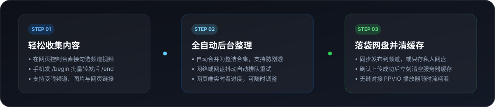

<div align="center">

<picture>
  
</picture>

<br/>

<p>
  <a href="#快速开始"></a>
  <a href="#网页控制台与隐私防窥"></a>
  <a href="https://github.com/Xioaruan912/PPVIO"></a>
</p>

<h3>把喜欢的 Telegram 视频与图片，轻松收集进自己的频道和私人网盘。</h3>
<p>不用再手动下载、转存、担心过期或被限速 —— 转发给机器人，或在网页里勾选，剩下的交给 TGVIO。</p>

</div>

---

## 一眼看懂怎么用

<div align="center">
  
</div>

想看的时候，直接打开配套的私人播放器 **[PPVIO](https://github.com/Xioaruan912/PPVIO)**：它直接读取你网盘里的原片，不卡顿、不受 Telegram 限速，两个工具互不打扰。

---

## 为什么日常用起来很顺手

<table>
  <tr>
    <td width="50%" valign="top">
      <h3>🖥️ 网页控制台，像 Mac 应用一样清爽</h3>
      <p>在独立网页里直接浏览你加入的频道（包括禁止转发的受限频道），支持 <code>Shift</code> 连选与一键全选。选好后按一下按钮，就能「合并发布到频道」或「仅备份到网盘」。</p>
    </td>
    <td width="50%" valign="top">
      <h3>📱 手机攒合集，不怕漏也不怕重启</h3>
      <p>在 Telegram 里发 <code>/begin</code> 开始收集，一口气转发多条视频、图片或链接，发完 <code>/end</code> 自动合并提交。草稿实时保存，即使服务器重启也不会丢，还能在网页里删掉误发的条目。</p>
    </td>
  </tr>
  <tr>
    <td width="50%" valign="top">
      <h3>🛡️ 天生为隐私设计，公共场合安心看</h3>
      <p>网页控制台<strong>严禁播放任何视频</strong>，仅用于挑选和看进度。默认开启「防窥脱敏」隐藏缩略图和标题，按 <code>Shift + H</code> 一秒切换待机时钟遮屏，切走浏览器标签页也会自动保护。</p>
    </td>
    <td width="50%" valign="top">
      <h3>☁️ 网盘稳、不占服务器硬盘</h3>
      <p>遇到网络波动或网盘临时抽风会自动排队重试，确认完整上传后再结束任务；一旦备份成功，立刻清空服务器本地临时缓存，小容量服务器也能长久安心运行。</p>
    </td>
  </tr>
</table>

<div align="center">
  
</div>

---

## Telegram 常用指令速查

| 指令 | 作用 |
| :--- | :--- |
| `/begin` | 开始一次手动收集（之后的转发都会先攒进草稿，不会零散发送） |
| `/end` | 结束收集，合并整理并发布到频道 + 备份网盘 |
| `/end_archive` | 结束收集，**只存网盘**（不发到频道，也可写 `/end archive`） |
| `/undo` | 误转发了？撤回刚刚暂存的最后一条 |
| `/cancel` | 取消这次收集并清空草稿 |
| `/status` | 随时查看当前草稿数量、下载队列与网盘备份状态 |

---

## 快速开始

只需要一台装有 Docker 的 Linux 服务器，提前准备好你的机器人 Token（在 `@BotFather` 申请）、Telegram API 密钥（在 `my.telegram.org` 获取）和目标频道即可。

```bash
git clone https://github.com/Xioaruan912/TGVIO.git
cd TGVIO
bash install.sh
```

运行后选择 **「1) 安装并启动」**，跟着中文向导填完几项基础信息，脚本会自动完成构建、自检并启动服务。完成后在 Telegram 里给机器人发送 `/start` 即可开始使用。

> 之后想修改配置、开启网盘备份、查看日志或更新版本，再次运行 `bash install.sh` 即可在菜单里一键操作。

### ✨ 不会敲命令？直接让你的 AI 帮你装

把下面这段话直接复制给你的 AI 助手（Antigravity / Cursor / Claude Code 等），让它全程一步步带你完成服务器部署与 HTTPS 网页控制台配置：

```text
请帮我部署 https://github.com/Xioaruan912/TGVIO.git 。
先阅读仓库的 README.md 和 AGENTS.md，然后用通俗中文一步步向我索要必要信息
（服务器 SSH、Telegram Bot Token、API_ID/API_HASH、目标频道、我的用户 ID，以及可选的网页控制台域名与网盘 WebDAV 配置）。
优先通过项目自带的 install.sh 和 Docker Compose 完成安装；如果我要开启网页控制台，请帮我配置宿主机 Nginx + HTTPS 反向代理到 127.0.0.1:8792。
全程不要泄露或提交我的任何密钥与 session，部署完成后帮我确认容器 healthy 并告诉我如何在 Telegram 里开始使用。
```

---

## 配套生态

| 项目 | 它负责什么 |
| :--- | :--- |
| **[TGVIO](https://github.com/Xioaruan912/TGVIO)**（本仓库） | 负责收集、整理、发布到频道，并把原片稳定备份进网盘 |
| **[PPVIO](https://github.com/Xioaruan912/PPVIO)** | 独立的个人视频播放器，直接读取网盘原片，支持封面、收藏、去重与流畅播放 |

---

<details>
<summary><strong>🔧 进阶配置、运维发布与开发者入口（展开查看）</strong></summary>

<br/>

- **开启网页控制台**：在 `.env` 中设置 `TGVIO_CONSOLE_ENABLED=true`、`TGVIO_CONSOLE_SECRET`（建议 32 位以上随机密钥）与 `TGVIO_CONSOLE_URL=https://你的域名`。服务仅在本机 `127.0.0.1:8792` 监听，建议通过宿主机 Nginx 配置 HTTPS 反向代理访问。
- **数据与备份**：`.env`、`data/`（状态数据库）、`session/`（登录会话）、`downloads/`（临时缓存）、`logs/` 均保存在服务器本地，迁移机器时一并打包即可，**切勿提交到仓库或外传**。
- **生产环境一键发布（维护者）**：仅接受已推送到 `main` 的干净提交，自动保留回滚点，详见 [运维规程](docs/operations/README.md)：
  ```bash
  python3 scripts/deploy_hostdzire.py --phase R2-NN
  ```
- **参与开发**：请先阅读 [AGENTS.md](AGENTS.md) 了解架构约定与代码地图；提交前运行 `bash scripts/check.sh`。本项目基于 [LICENSE](LICENSE) 开源。

</details>

---

> **🤖 致 AI Agent（部署与开发指引）**
>
> - **帮普通用户部署时**：用通俗中文分步引导用户准备凭证，优先通过 `bash install.sh` / `.env.example` + Docker Compose 完成安装；若启用网页控制台，保持容器仅监听 `127.0.0.1:8792` 并由宿主机 Nginx 提供 HTTPS 反代；严禁将 `.env`、Token、密钥或 Session 写入 Git 或明文回显；完成后核验容器 `healthy` 与 `/healthz`。
> - **接手二次开发时**：请先完整阅读根目录的 **[AGENTS.md](AGENTS.md)**（已固化苹果风工作流、严格禁播与全局防窥红线、测试与 VPS 发布门禁）。`AGENTS.md` 已确立的核心工作流与红线**只允许在文末续写区或 `docs/handoffs/` 中增量追加，严禁覆盖或删改前序规范**，且提交记录请勿附带 AI `Co-Authored-By` 署名。
